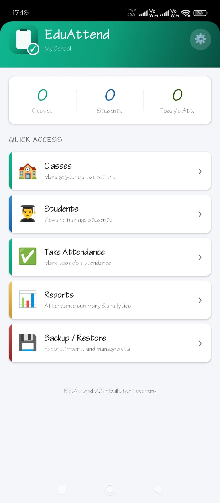
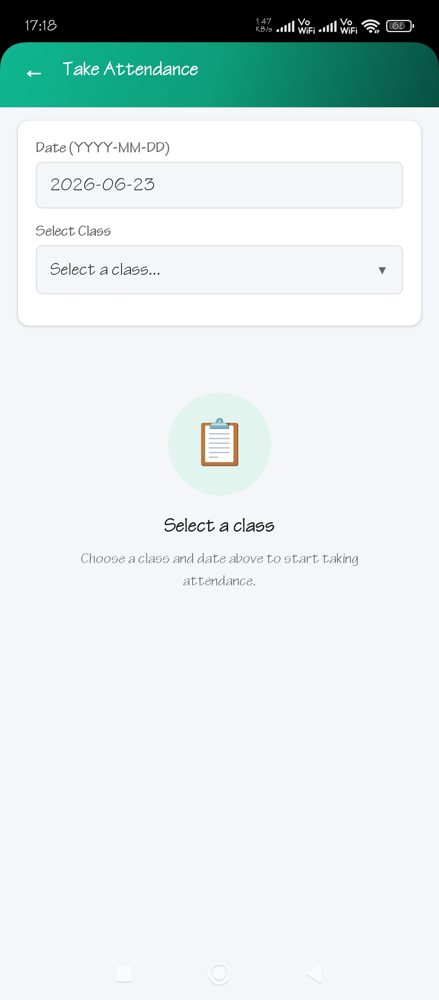
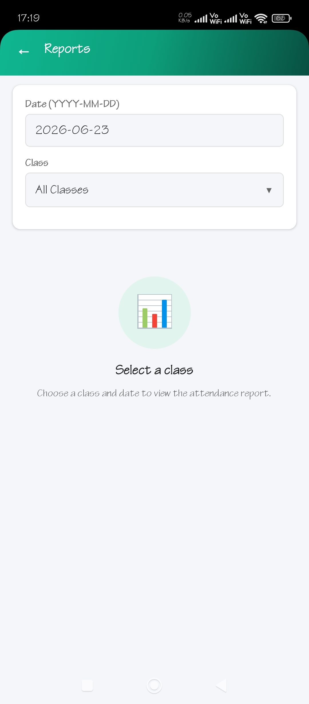
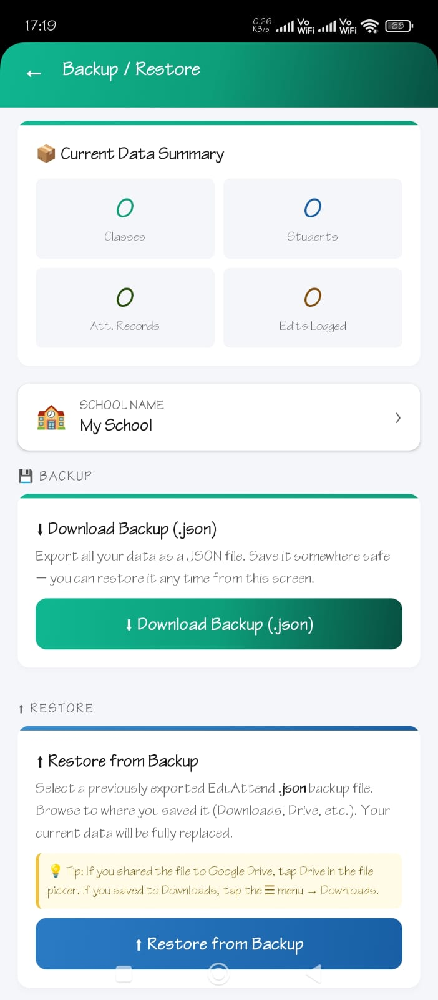

<div align="center">


# EduAttend

### University Attendance Management App for Android

[](https://expo.dev)
[](https://reactnative.dev)
[](https://android.com)
[](LICENSE)

A professional mobile attendance app built for university teachers.  
Manage classes, students, and daily attendance — fully offline, with Excel export.

[Features](#features) • [Screenshots](#screenshots) • [Tech Stack](#tech-stack) • [Getting Started](#getting-started) • [Build APK](#build-apk)

</div>

---

## Features

### 📋 Attendance Management
- Mark students **Present / Absent / Leave** with one tap
- Default status: Absent (A) — tap to change
- P/A/L buttons with satisfying spring animations
- Auto-saves per class per date

### ✏️ Edit Mode with Audit Log
- Locked buttons prevent accidental changes after saving
- **Edit Mode** unlocks corrections with visual amber highlight
- Every change is logged with student name, old status → new status, and timestamp
- Last 20 edits visible per attendance session

### 🏫 Class Management
- Add, edit, and delete class sections
- Per-class: teacher name, date range, student count
- Quick shortcuts to Take Attendance and Reports from every class card

### 👨‍🎓 Student Management
- Filter students by class
- Student profiles: name, registration number, class, gender, date of admission
- Initials avatar with gender-based color coding

### 📊 Reports
- Filter by class + date
- Stats boxes: Present count, Absent count, Leave count with percentages
- Per-student colored status badges
- Direct "Take Attendance" shortcut for dates with no record

### 📁 Excel Export (.xlsx)
- Full attendance register matching the official printed format
- Multi-row header: **MONTH / DATE / LEC** rows
- Live Excel formulas: `Att = COUNTIF(...)`, `Att% = ROUND(...)`
- Bold headers, Arial 8pt fonts, thin borders on every cell
- Exports per-class or all classes in one workbook (one sheet per class)

### 💾 Backup & Restore
- JSON backup includes classes, students, attendance, edit history, and settings
- Restore via native file picker — uses `expo-file-system`'s modern `File.pickFileAsync()` + `.text()` API (bypasses the known Android content-URI legacy bridge bug)
- Double-confirm Clear All Data

### ⚙️ Settings
- Set your **school / department name** — appears at the top of every exported Excel register instead of a generic department title
- Persists across restarts, survives "Clear All Data"

### 🎨 Professional Design
- Teal-to-emerald gradient headers and buttons
- Animated staggered card entrances on all list screens
- Spring-bounce animation on attendance button selection
- Circular icon backdrop on empty states
- Actionable empty states with CTA buttons (no dead ends)
- Clipboard-with-checkmark app icon, clean under all Android launcher masks

---

## Screenshots

> *(Add screenshots here after first run — `npx expo start --clear` → open in Expo Go → screenshot)*

| Home | Classes | Take Attendance | Reports |
|------|---------|-----------------|---------|
|  |  |  |  |

| Edit Mode | Students | Backup | Settings |
|-----------|---------|--------|----------|
|  |  |  |  |

---

## Tech Stack

| Layer | Technology |
|-------|-----------|
| Framework | React Native + Expo SDK 56 |
| Navigation | expo-router (file-based) |
| State | React Context API |
| Storage | @react-native-async-storage/async-storage |
| File I/O | expo-file-system (legacy + modern `File` API) |
| Sharing | expo-sharing |
| File Picker | expo-file-system `File.pickFileAsync()` |
| Excel Export | xlsx-js-style |
| Gradients | expo-linear-gradient |
| Animations | React Native `Animated` API (no third-party) |
| Styling | StyleSheet only (no external UI libraries) |
| Icons | Unicode emoji (no icon libraries) |

---

## Project Structure

```
EduAttend/
├── app/                        # expo-router screens
│   ├── _layout.js              # Root layout + AppProvider
│   ├── index.js                # Home screen
│   ├── classes.js              # Class management
│   ├── students.js             # Student management
│   ├── attendance.js           # Take + Edit attendance
│   ├── reports.js              # Attendance reports
│   ├── backup.js               # Backup / Restore / Export
│   └── settings.js             # School name setting
├── src/
│   ├── components/
│   │   └── UI.js               # Shared components:
│   │                           #   Logo, Header, PrimaryBtn, InputField,
│   │                           #   Card, FadeInUp, Avatar, AttBtn,
│   │                           #   StatusBadge, StatBox, EmptyState,
│   │                           #   Chip, BottomSheetModal, EditHistoryItem,
│   │                           #   PickerRow
│   ├── context/
│   │   └── AppContext.js       # Global state + all CRUD functions
│   └── utils/
│       ├── theme.js            # COLORS, GRADIENTS, SIZES, FONTS
│       ├── storage.js          # AsyncStorage load/save/clear
│       └── xlsxExport.js       # Excel + JSON backup exporters
├── assets/
│   ├── icon.png                # App icon (1024×1024)
│   ├── adaptive-icon.png       # Android adaptive icon foreground
│   └── splash-icon.png         # Splash screen icon (SDK 56 API)
├── app.json                    # Expo config
└── package.json
```

---

## Data Models

```js
// Class
{ id: number, name: string, teacher: string, start: string, end: string }

// Student
{ id: number, name: string, reg: string, classId: number|null,
  gender: 'Male'|'Female'|'Other', doa: string }

// Attendance (AsyncStorage key: "YYYY-MM-DD_classId")
{ [studentId]: 'P' | 'A' | 'L' }

// EditHistory (AsyncStorage key: "YYYY-MM-DD_classId")
[{ student: string, from: string, to: string, time: string }]

// Settings (AsyncStorage key: "eduattend_settings")
{ schoolName: string }
```

---

## Getting Started

### Prerequisites

- Node.js 18+
- npm
- [Expo Go](https://expo.dev/go) on your Android phone (SDK 56 — update to latest)

### Clean Install

```bash
# 1. Clone the repo
git clone https://github.com/YOUR_USERNAME/EduAttend.git
cd EduAttend

# 2. Allow Expo's peer dependency resolution (required for expo-router)
echo "legacy-peer-deps=true" > .npmrc

# 3. Install Expo and the pure-JS libraries
npm install expo@~56.0.0
npm install xlsx-js-style

# 4. Let Expo resolve every native module at the correct SDK 56 version
npx expo install expo-router expo-linking expo-status-bar expo-file-system \
  expo-sharing expo-document-picker expo-linear-gradient expo-splash-screen \
  @react-native-async-storage/async-storage react-native-safe-area-context \
  react-native-screens react react-native

# 5. Safety net — fix any remaining version mismatches
npx expo install --fix

# 6. Start Metro
npx expo start --clear
```

### Running on your phone

1. Make sure your phone and laptop are on the **same WiFi network**
2. Scan the QR code with Expo Go (Android)
3. The app bundles and opens on your device

If your phone and laptop aren't on the same network:
```bash
npx expo start --tunnel
```

---

## Build APK

To build a real, installable `.apk` (no Expo Go required):

```bash
# 1. Install EAS CLI
npm install -g eas-cli

# 2. Log in with your Expo account (free at expo.dev/signup)
eas login

# 3. Configure the project
eas build:configure

# 4. Build for Android
eas build --platform android --profile preview
```

~15 minutes later you'll get a direct download link. Open it on your phone,
tap install, and EduAttend runs as a standalone app with its own icon.

---

## Export Format

The Excel register matches the official printed format used in universities:

```
Row 1:  School / Department Name
Row 2:  TEACHER NAME :  <name>
Row 3:  CLASS NAME :  <name>    Total Classes : N    startDate  To :  endDate
Row 4:  S.N. | MONTH >  |  2  |  2  |  3  |  3  | ... | Att | Att%
Row 5:       | DATE >   |  9  | 10  | 11  | 17  | ...
Row 6:       | REG NUMBER | STUDENT NAME          LEC > |  1  |  2  | ...
Row 7+: i    | reg        | name  | P/A/L per date | =COUNTIF(...) | =ROUND(...)
```

Att and Att% columns use live Excel formulas — editing a P/A/L in the
exported sheet automatically recalculates totals.

---

## Contributing

Pull requests are welcome. For major changes, please open an issue first.

1. Fork the repo
2. Create your feature branch: `git checkout -b feature/your-feature`
3. Commit your changes: `git commit -m 'Add some feature'`
4. Push to the branch: `git push origin feature/your-feature`
5. Open a Pull Request

---

## License

MIT © 2026 — feel free to use, modify, and distribute.

---

<div align="center">
Built with ❤️ for teachers who deserve better tools.
</div>
